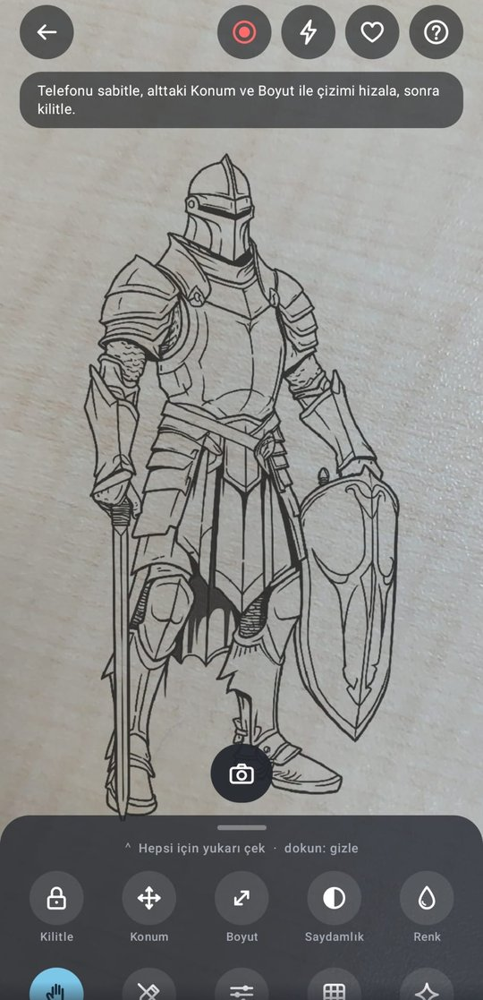
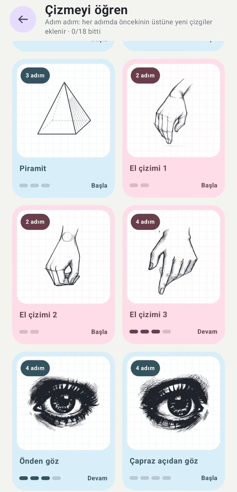
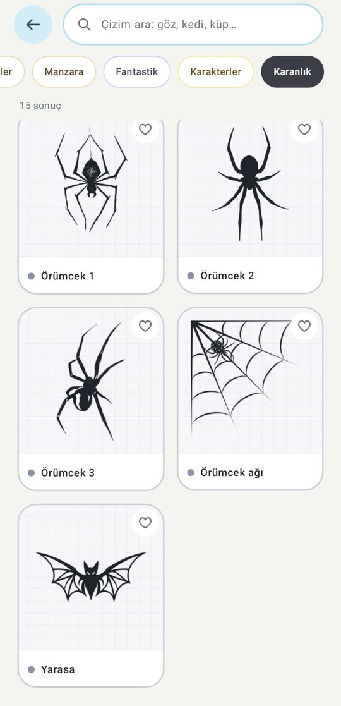
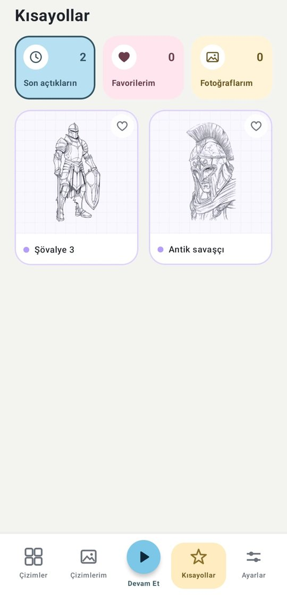
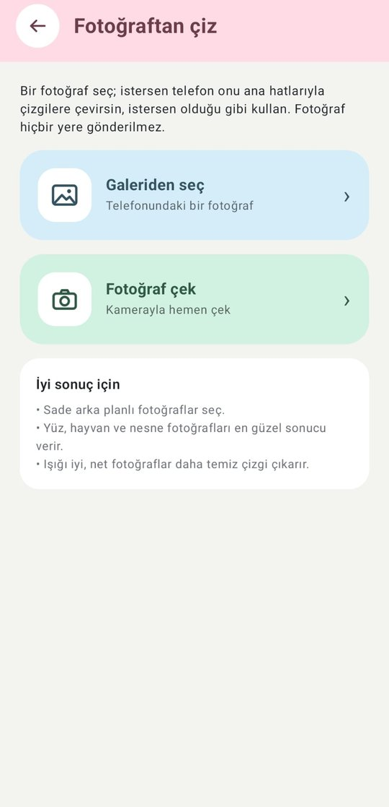
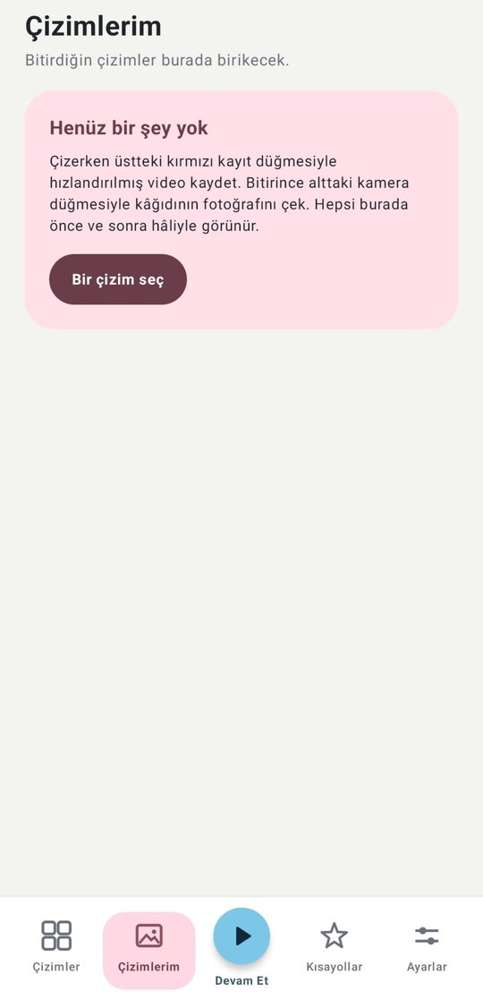
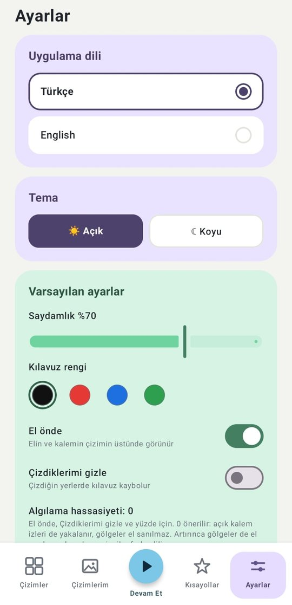
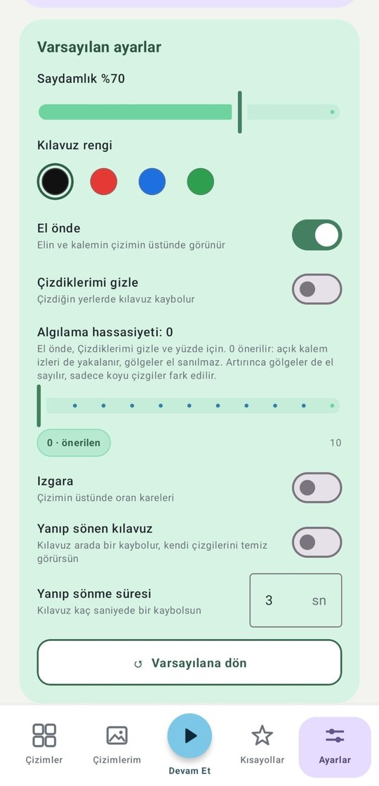

<div align="center">

# ✏️ İlk Çizgi

**Kâğıda yansıt ve çizime başla.**

Telefonunu kâğıdın üstüne sabitle, ekrandaki kılavuzu takip ederek çiz.
Çizim bilmene gerek yok; adım adım derslerle ilk çizgini sen çek.


*Alteration Studio*

</div>

---

## Ekran görüntüleri

<table>
  <tr>
    <td align="center"><br><sub><b>Çizim ekranı</b><br>Kamera üstünde kılavuz</sub></td>
    <td align="center"><br><sub><b>Çizmeyi öğren</b><br>18 adım adım ders</sub></td>
    <td align="center"><br><sub><b>Arama ve filtre</b><br>Kategoriye göre süz</sub></td>
    <td align="center"><br><sub><b>Kısayollar</b><br>Son açılanlar, favoriler</sub></td>
  </tr>
  <tr>
    <td align="center"><br><sub><b>Fotoğraftan çiz</b><br>Galeriden ya da kamerayla</sub></td>
    <td align="center"><br><sub><b>Çizimlerim</b><br>Video ve fotoğraflar</sub></td>
    <td align="center"><br><sub><b>Ayarlar</b><br>Dil ve tema</sub></td>
    <td align="center"><br><sub><b>Varsayılan ayarlar</b><br>Her çizim böyle açılır</sub></td>
  </tr>
</table>

## Nasıl çalışır?

1. **Bir çizim seç.** Kategorilerden, adım adım derslerden ya da kendi fotoğrafından.
2. **Telefonu sabitle.** Kâğıdın 30–40 cm üstünde bir bardağa, kitaplara ya da bir standa yasla.
3. **Hizala ve kilitle.** Kamera görüntüsünün üstündeki çizimi konum ve boyut araçlarıyla kâğıda oturt, sonra kilitle.
4. **Ekrana bakarak çiz.** Kalemin ve elin çizimin önünde görünür, çizdiğin yerler kaybolur, ne kadarını bitirdiğini yüzde olarak görürsün.

## Özellikler

### Çizim ekranı
- **Kamera üstünde kılavuz:** çizim, kamera görüntüsünün üstünde yarı saydam durur; telefon sabit olduğu için kâğıttan kaymaz.
- **El önde:** elin ve kalemin çizimin üstünde görünür.
- **Çizdiklerimi gizle:** kalemle geçtiğin yerlerde kılavuz kaybolur; kalan iş bir bakışta görünür.
- **İlerleme yüzdesi:** kilitliyken kâğıttaki kalem izleri sayılır; yüzde 5 saniyede bir baştan hesaplanır, telefon kayarsa ya da gölge düşerse yanlış sayım kendiliğinden düzelir.
- **Kilit (ekranın üstünde):** konumu sabitler; kameranın odağını, ışığını ve renk dengesini de kilitler.
- **Sade görünüm:** kilidin yanındaki göz düğmesi ekrandaki her şeyi gizler; çizerken sadece çizim, kilit ve bu düğme kalır.
- **Araçlar:** konum (milim milim kaydırma, yarım derece döndürme), boyut, saydamlık, kılavuz rengi, **arka plan** (çizimi beyaz, siyah, kırmızı, mavi ya da yeşil düz zeminde gösterir; resme bakarak çizmek için), aynalama, ızgara, yanıp sönen kılavuz, algılama hassasiyeti.
- **Üç kademeli alt araç çubuğu:** gizli, yarı açık ya da tam açık; yukarı çekince tam açılır.
- **Hızlandırılmış video** ve **kâğıdın fotoğrafı:** çizim sürecin galeriye ve "Çizimlerim"e kaydedilir. Videolar uygulamanın kendi oynatıcısında, istenen hızda (0,25×–2×) izlenir.
- **Devam Et:** son çizimi aynı yer, boyut ve ayarlarla tek dokunuşla yeniden açar.
- **Son açtıkların:** Kısayollar'daki son 12 çizimin her biri en son bıraktığın yer, boyut ve ayarlarla açılır.

### Çizmeyi öğren
- Küp, silindir, koni, küre, piramit, el, göz, burun, dudak ve yüz için **18 adım adım ders.**
- Her adım öncekinin tam üstüne oturur; çizdiklerinin üstüne yeni çizgiler eklenir.

### Kendi fotoğrafın
- Galeriden seç ya da çek; telefon onu **ana hatlarıyla, net ve koyu çizgilere çevirir** (ayrıntı ve çizgi kalınlığı ayarlanabilir). Kenar yönünü takip ettiği için çizgiler kesik kesik değil, akıcı çıkar.
- İstersen fotoğrafı **olduğu gibi** kullan ve saydamlığını ayarlayarak üstünden çiz.
- Fotoğraflar hiçbir yere gönderilmez; her şey telefonda işlenir.

### Çizimler
**Kolay çizimler · İnsan · Hayvanlar · Bitkiler · Manzara · Fantastik · Karakterler · Karanlık**

Türkçe harflere duyarsız arama ("goz" yazınca "Göz" bulunur), kategori filtresi, favoriler ve son açılanlar.

Her çizimin altında iki düğme var: **Çiz** kamerayı açıp çizime başlatır, **Önizle** kamera açmadan çizime bakmanı sağlar. Önizlemede çizim parmakla kaydırılır, iki parmakla büyütülür ve döndürülür; boyut, aynalama, ızgara, kılavuz rengi ve arka plan denenir, göz düğmesiyle ayarlar gizlenip kâğıt büyütülür. "Çizmeye başla" çizimi aynı ayarlarla açar.

### Uygulama
- Türkçe ve İngilizce.
- Açık ve koyu tema (koyu temada bile çizimler beyaz kâğıt üstünde siyah görünür).
- İlk açılışta kısa tanıtım ve uygulama içinde "Nasıl kullanılır" rehberi.

## Teknik

| | |
|---|---|
| Dil | Kotlin 2.4 |
| Arayüz | Jetpack Compose, Material 3 |
| Kamera | CameraX 1.6 (Camera2 ile odak/ışık kilidi) |
| Görüntü işleme | Kendi algoritmamız: YUV kareden el ve kalem izi algılama; fotoğraftan çizgi çıkarma (kenar koruyan süzgeç + akış tabanlı DoG + histerezis) |
| Video | MediaCodec (H.264) + MediaMuxer |
| Android | En az 7.0 (API 24), hedef API 36 |

Android/AndroidX dışında kütüphane yok: simgeler, görüntü işleme ve video kodlama uygulamanın kendi kodudur.
Uygulama **internet izni istemez**.

### Proje yapısı

```
app/src/main/
├─ java/com/alterationstudio/ilkcizgi/
│  ├─ MainActivity.kt      ekranlar arası geçiş ve alt sekmeler
│  ├─ DrawingScreen.kt     kamera + çizim ekranı ve araç çubuğu
│  ├─ PreviewScreen.kt     kamerasız önizleme
│  ├─ Vision.kt            el / çizgi algılama, ilerleme hesabı
│  ├─ PhotoSketch.kt       fotoğraftan çizgi çizimi
│  ├─ Timelapse.kt         hızlandırılmış video
│  ├─ Works.kt             Çizimlerim
│  ├─ HomeScreen.kt        ana sayfa ve kategoriler
│  ├─ AppUi.kt             renkler, dil, ayarlar, katalog, dersler
│  └─ …                    arama, ayarlar, tanıtım, simgeler
└─ assets/drawing/
   ├─ kategoriler.json     kategori ve çizim adları, dersler
   └─ <kategori klasörleri>
```


## Geliştiriciler
Hamza Bilici - Emel Ece Gizli


