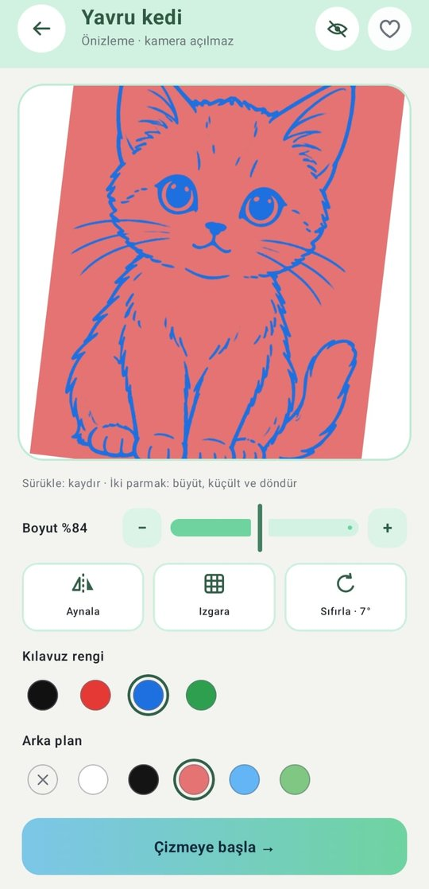
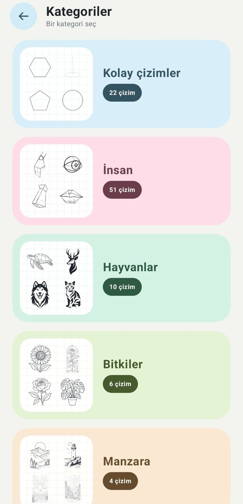
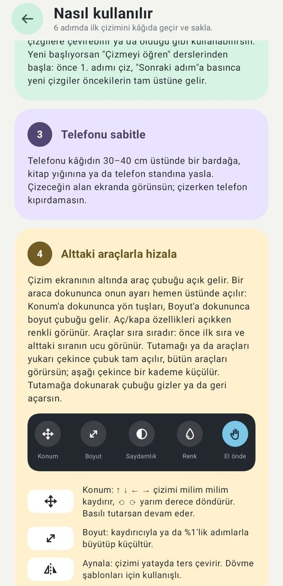
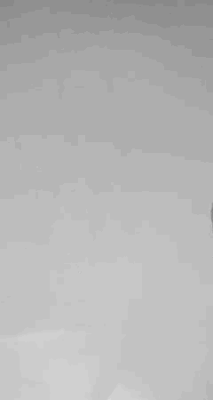
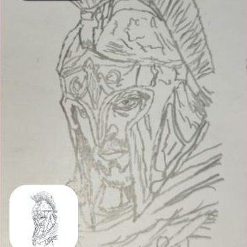
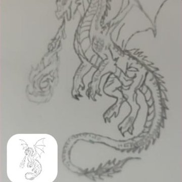
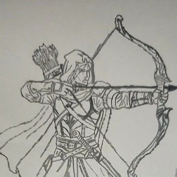
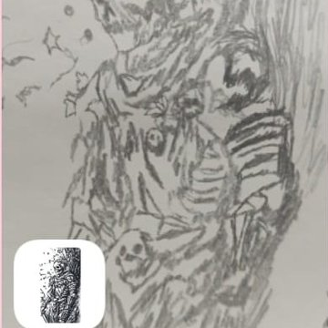

<div align="center">

# ✏️ İlk Çizgi

**Kâğıda yansıt ve çizime başla.**

Telefonunu kâğıdın üstüne sabitle, ekrandaki kılavuzu takip ederek çiz.
Çizim bilmene gerek yok; adım adım derslerle ilk çizgini sen çek.


*Alteration Studio*

</div>

---

## Hangi sorunu çözüyor?

Çizime yeni başlayan biri bir resme bakarak çizdiğinde oranlar kayar: baş büyük, kollar kısa, yüz yamuk çıkar. Işık masası, ızgara ya da karbon kâğıt gibi yöntemler ek malzeme ister ve çizmeyi öğretmez. Telefondaki benzer uygulamalarda ise kılavuz elin üstünde kalır, kendi çizdiğin çizgilerle karışır ve gelişmiş özellikler ücretlidir.

İlk Çizgi'de telefon kâğıdın üstünde sabit durur, seçilen çizim kamera görüntüsünün üstünde yarı saydam görünür. Ekrana bakıp çizgilerin üstünden geçersin; uygulama elini çizimin önüne alır, çizdiğin yerleri gizler ve ne kadarını bitirdiğini gösterir.

## Ekran görüntüleri

<table>
  <tr>
    <td align="center"><br><sub><b>Çizim ekranı</b><br>Kamera üstünde kılavuz ve araçlar</sub></td>
    <td align="center"><br><sub><b>Çizmeyi öğren</b><br>Adım adım dersler</sub></td>
    <td align="center"><br><sub><b>Önizle</b><br>Kamerasız; kaydır, büyüt, döndür</sub></td>
    <td align="center"><br><sub><b>Kategoriler</b><br>Kolaydan zora çizimler</sub></td>
  </tr>
  <tr>
    <td align="center"><br><sub><b>Fotoğraftan çiz</b><br>Galeriden ya da kamerayla</sub></td>
    <td align="center"><br><sub><b>Çizimlerim</b><br>Video ve fotoğraflar</sub></td>
    <td align="center"><br><sub><b>Nasıl kullanılır</b><br>6 adımlı rehber</sub></td>
    <td align="center"><br><sub><b>Ayarlar</b><br>Dil, tema, varsayılanlar</sub></td>
  </tr>
</table>

## Uygulamayla çizildi

<table>
  <tr>
    <td align="center" rowspan="2"><br><sub><b>Hızlandırılmış video (29×)</b><br>Yaklaşık 10 dakikalık çizim, 20 saniye</sub></td>
    <td align="center"><br><sub>Antik savaşçı</sub></td>
    <td align="center"><br><sub>Ejderha</sub></td>
  </tr>
  <tr>
    <td align="center"><br><sub>Okçu</sub></td>
    <td align="center"><br><sub>İskelet savaşçı</sub></td>
  </tr>
</table>

Hepsi kâğıda, kalemle, İlk Çizgi'nin kılavuzu takip edilerek çizildi.

## Nasıl kullanılır?

1. **Bir çizim seç.** Kategorilerden, adım adım derslerden ya da kendi fotoğrafından. İstersen önce kamerayı açmadan **Önizle**.
2. **Telefonu sabitle.** Kâğıdın 30–40 cm üstünde bir bardağa, kitaplara ya da bir standa yasla.
3. **Hizala ve kilitle.** Kamera görüntüsünün üstündeki çizimi konum ve boyut araçlarıyla kâğıda oturt, sonra üstteki kilide bas.
4. **Ekrana bakarak çiz.** Elin ve kalemin çizimin önünde görünür, çizdiğin yerler kaybolur, ne kadarını bitirdiğini yüzde olarak görürsün.

## Özellikler

### Çizim ekranı
- **Kamera üstünde kılavuz:** çizim, kamera görüntüsünün üstünde yarı saydam durur; telefon sabit olduğu için kâğıttan kaymaz. AR desteği gerekmez.
- **El önde:** elin ve kalemin çizimin önünde görünür; kılavuz elinin üstüne binmez.
- **Çizdiklerimi gizle:** kalemle geçtiğin yerlerde kılavuz kaybolur; kalan iş bir bakışta görünür.
- **İlerleme yüzdesi:** kilitliyken kâğıttaki kalem izleri sayılır; yüzde 5 saniyede bir yeniden hesaplanır, telefon kayarsa ya da gölge düşerse yanlış sayım kendiliğinden düşer.
- **Kilit (ekranın üstünde):** çizimin yerini sabitler; kameranın odağını, ışığını ve renk dengesini de kilitler.
- **Sade görünüm:** kilidin yanındaki göz düğmesi ekrandaki her şeyi gizler; çizerken sadece çizim, kilit ve bu düğme kalır.
- **Araçlar:** konum (milim milim kaydırma, yarım derece döndürme), boyut, saydamlık, kılavuz rengi, **arka plan** (çizimi beyaz, siyah, kırmızı, mavi ya da yeşil düz zeminde gösterir), aynalama, ızgara, yanıp sönen kılavuz, **yansıtmayı gizle** ve **algılama hassasiyeti** (açık kalem izlerini sayar ya da gölgeleri el kabul eder).
- **Üç kademeli alt araç çubuğu:** gizli, yarı açık ya da tam açık; yukarı çekince tam açılır.
- **Hızlandırılmış video** ve **kâğıdın fotoğrafı:** kareler ekrandan değil kameradan alınır, bu yüzden videoda kılavuz görünmez. Hız 4×, 7×, 14× ya da 29× seçilir; videolar galeriye ve "Çizimlerim"e kaydedilir, uygulamanın kendi oynatıcısında istenen hızda (0,25×–2×) izlenir.
- **Devam Et:** son çizimi aynı yer, boyut ve ayarlarla tek dokunuşla yeniden açar.
- **Son açtıkların:** Kısayollar'daki son 12 çizimin her biri en son bıraktığın yer, boyut ve ayarlarla açılır.

### Çizmeyi öğren
- Basit şekillerden el, göz, burun, dudak, yüz ve portreye uzanan **adım adım dersler.**
- Her adım öncekinin tam üstüne oturur; "Sonraki adım"a basınca yeni çizgiler çizdiklerinin üstüne gelir.
- Uygulama kaldığın adımı hatırlar.

### Kendi fotoğrafın
- Galeriden seç ya da çek; telefon onu **ana hatlarıyla, net ve koyu çizgilere çevirir** (ayrıntı ve çizgi kalınlığı ayarlanabilir). Kenar yönünü takip ettiği için çizgiler kesik kesik değil, akıcı çıkar.
- İstersen fotoğrafı **olduğu gibi** kullan ve saydamlığını ayarlayarak üstünden çiz.
- Fotoğraflar hiçbir yere gönderilmez; her şey telefonda işlenir.

### Çizimler
**Kolay çizimler · İnsan · Hayvanlar · Bitkiler · Manzara · Fantastik · Karakterler · Karanlık**

Türkçe harflere duyarsız arama ("goz" yazınca "Göz" bulunur), kategori filtresi, favoriler ve son açılanlar. Kütüphane büyümeye açık: yeni bir çizim eklemek için klasöre resmi koymak yeter.

Her çizimin altında iki düğme var: **Çiz** kamerayı açıp çizime başlatır, **Önizle** kamera açmadan çizime bakmanı sağlar. Önizlemede çizim parmakla kaydırılır, iki parmakla büyütülür ve döndürülür; boyut, aynalama, ızgara, kılavuz rengi ve arka plan denenir. "Çizmeye başla" çizimi aynı ayarlarla açar.

### Uygulama
- Türkçe ve İngilizce.
- Açık ve koyu tema (koyu temada bile çizimler beyaz kâğıt üstünde siyah görünür).
- İlk açılışta kısa tanıtım ve her an açılabilen 6 adımlı "Nasıl kullanılır" rehberi.

## Nasıl çalışıyor?

Her kamera karesinde şunlar olur:

1. **Kamera karesi:** CameraX görüntüyü kare kare verir; ekranın değil, kameranın görüntüsü kullanılır.
2. **Kâğıdı tanı:** görüntü hücrelere bölünür, kâğıdın parlaklığı her karede yeniden ölçülür; ışık değişse de uyum sağlanır.
3. **Eli ve kalemi bul:** ten rengine yakın büyük lekeler el, çevresindeki kâğıttan belirgin koyu ve renksiz izler kalem çizgisi sayılır.
4. **Maske üret:** saniyede yaklaşık 15 kez; el ve çizilmiş yerler kılavuzdan çıkarılır, titremesin diye yumuşatılır.
5. **Çiz ve say:** kılavuz maskeyle ekrana çizilir; kılavuzun kapladığı hücrelerde kalem izi aranır, yüzde hesaplanır.

Fotoğraftan çizgi çıkarma da kendi algoritmamızdır (akış tabanlı DoG): doku ve gürültü kenar koruyan bir süzgeçle düzlenir, iki bulanıklığın farkıyla kenarlar bulunur, kenar yönünde kesik çizgiler birleştirilir, kısa parazitler atılır. Hesap telefonun çekirdeklerine bölünür.

## Teknik

| | |
|---|---|
| Dil | Kotlin 2.4 |
| Arayüz | Jetpack Compose, Material 3 (tek Activity) |
| Kamera | CameraX 1.6 (Camera2 ile odak/ışık kilidi) |
| Görüntü işleme | Kendi algoritmamız: YUV kareden el ve kalem izi algılama; fotoğraftan çizgi çıkarma (kenar koruyan süzgeç + akış tabanlı DoG + histerezis) |
| Video | MediaCodec (H.264) + MediaMuxer |
| Android | En az 7.0 (API 24), hedef API 36 |

Android/AndroidX dışında kütüphane yok: simgeler, görüntü işleme ve video kodlama uygulamanın kendi kodudur.
Uygulama **internet izni istemez**.

### Proje yapısı

```
app/src/main/
├─ java/com/alterationstudio/ilkcizgi/
│  ├─ MainActivity.kt      ekranlar arası geçiş ve alt sekmeler
│  ├─ DrawingScreen.kt     kamera + çizim ekranı ve araç çubuğu
│  ├─ PreviewScreen.kt     kamerasız önizleme
│  ├─ Vision.kt            el / çizgi algılama, ilerleme hesabı
│  ├─ PhotoSketch.kt       fotoğraftan çizgi çizimi
│  ├─ Timelapse.kt         hızlandırılmış video
│  ├─ Works.kt             Çizimlerim ve video oynatıcı
│  ├─ HomeScreen.kt        ana sayfa ve kategoriler
│  ├─ Sections.kt          dersler ve Kısayollar
│  ├─ AppUi.kt             renkler, dil, ayarlar, katalog, dersler
│  └─ …                    arama, ayarlar, tanıtım, rehber, simgeler
└─ assets/drawing/
   ├─ kategoriler.json     kategori ve çizim adları, dersler
   └─ <kategori klasörleri>
```

## Geliştiriciler
Hamza Bilici - Emel Ece Gizli

© 2026 Alteration Studio
